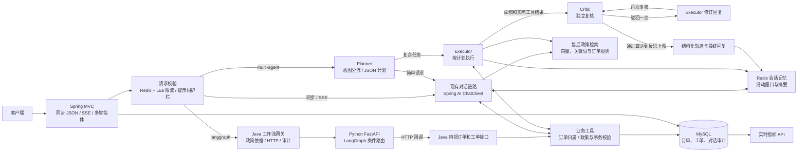

# Enterprise Copilot Agent

一个面向企业客服的 Java 21 / Spring Boot 3.4 后端。支持查询订单、按售后政策登记工单、SSE 流式对话、Java 多智能体编排和 Python LangGraph 工作流。MySQL 保存业务与审计数据，Redis 保存跨实例会话记忆和请求限流状态。

## 架构



## 工程亮点

| 能力 | 设计 |
| --- | --- |
| 流式对话 | 同步和 SSE 使用同一套 ChatClient 与系统提示。SSE 保留原始文本分片，工具 JDBC 调用在工作线程执行。 |
| Redis 记忆 | 按用户与会话分桶，TTL 为 24 小时。超过 10 条消息后保留 1 条规则摘要和最近 6 条原话。提交完整问答，清空后在途请求无法恢复旧历史。 |
| 业务工具 | 支持查单、列订单、查工单和创建售后工单。先校验订单归属与售后政策，再在持有订单行锁的事务内检查并创建工单。重复的待审核申请返回原单号。 |
| 政策检索 | Markdown 分片通过向量与关键词联合排序，综合门槛为 0.65。默认用本地 N-gram 向量和 JSON 缓存，可配置独立的 OpenAI 兼容 Embedding 接口。政策原文仅注入当轮系统消息。 |
| 请求治理 | Redis Lua 使用服务端时钟，每个用户在滚动 60 秒内最多 15 次，超限返回 429 和 `Retry-After`。提示词护栏命中返回 403，审计只保存规则标记。 |
| 可观测性 | 每次对话按请求记录首见工具顺序和端到端耗时。MySQL 聚合请求量、会话量、平均延迟和工具排行，统计接口只返回聚合结果。 |
| 多智能体 | Planner 和 Critic 通过 Spring AI `.entity(...)` 转换 JSON 为 Java Record，并在本地校验必填字段和建单步骤。Executor 仅暴露计划中的工具，按序执行并将实际工具结果交给 Critic。反思最多一次，单独修订答复，原始问题与最终答复按会话写入 Redis。 |
| 跨语言工作流 | Java 完成限流、输入校验、政策检索和审计。Python 用 LangGraph 条件边处理建单、人工核对与咨询，通过具备服务间鉴权的 Java HTTP 接口读取订单和登记工单。 |

### 简历描述

基于 Spring AI 实现企业客服的 Plan-and-Solve 编排。以结构化计划分流简单请求与多步业务，结合售后政策和实际工具回执进行独立复核，限制单轮工具调用与反思次数，并接入 Redis 会话记忆、MySQL 事务校验和统一审计。

## Docker Compose 启动

需要 Docker Engine 与 Compose。Windows 可使用启用 WSL 2 的 Docker Desktop，镜像使用 Linux 容器。以下命令适用于 PowerShell 7，也可以将 `DEEPSEEK_API_KEY` 存入仓库根目录已被 Git 忽略的 `.env` 文件。

```powershell
$env:DEEPSEEK_API_KEY = Read-Host -MaskInput 'DeepSeek API Key'
docker compose up --build -d
docker compose ps
Invoke-RestMethod http://127.0.0.1:8080/api/health/check
```

暂时没有模型密钥时，可以直接启动并体验健康检查、知识库检索和指标接口。对话通过输入校验后会返回 503，提示配置密钥。

- 应用默认发布到宿主机 `127.0.0.1:8080`。端口冲突时可设置 `APP_PORT=18080`。MySQL 和 Redis 使用 Compose 内部网络。
- MySQL 首次启动时加载三张业务表及三笔演示订单。应用使用独立的 MySQL 用户。重新创建容器时，命名卷保留业务数据、Redis 数据和知识索引。
- Compose 提供本机演示密码。可通过 `MYSQL_ROOT_PASSWORD`、`MYSQL_USER` 和 `MYSQL_PASSWORD` 覆盖。首次创建 MySQL 数据卷时设置这些变量。
- 可选配置 `EMBEDDING_BASE_URL`、`EMBEDDING_API_KEY` 和 `EMBEDDING_MODEL` 切换向量模型。通过 `EMBEDDING_PATH` 覆盖默认的 `/v1/embeddings` 路径。

停止应用与中间件时运行 `docker compose down`。查看启动日志可运行 `docker compose logs -f app`。

## API 示例

下面的请求体适用于 `POST /api/chat` 和 `POST /api/chat/stream`。

```json
{
  "sessionId": "resume-demo-01",
  "userId": "U1001",
  "message": "请帮我查询订单 ORD-2026001 的状态"
}
```

```powershell
$base = 'http://127.0.0.1:8080'
$body = @{
    sessionId = 'resume-demo-01'
    userId = 'U1001'
    message = '请帮我查询订单 ORD-2026001 的状态'
} | ConvertTo-Json -Compress

Invoke-RestMethod "$base/api/chat" -Method Post -ContentType 'application/json; charset=utf-8' -Body $body
$body | curl.exe -N "$base/api/chat/stream" -H 'Content-Type: application/json' -H 'Accept: text/event-stream' --data-binary '@-'
Invoke-RestMethod "$base/api/metrics/summary"
```

| 请求 | 用途 |
| --- | --- |
| `POST /api/chat/multi-agent` | 返回 `plan`、`review`、`reflectionTriggered`、`toolsInvoked`、`totalLatencyMs` 和 `finalReply`。简单任务沿用原链路，`review` 为 `null`。 |
| `GET /api/health/check` | 验证 MySQL、Redis 和样例订单数据。 |
| `GET /api/knowledge/search?query=专线宽带已经完成了能退款吗` | 返回政策内容、综合分、文档名和条款编号。 |
| `POST /api/knowledge/reload` | 重新加载受信任的 Markdown，验证成功后原子切换索引。 |
| `DELETE /api/chat/memory/resume-demo-01?userId=U1001` | 清空用户会话的 Redis 记忆。 |
| `GET /api/metrics/summary` | 获取审计请求数、独立会话数、平均延迟和工具分布。 |

用相同的请求体调用 `POST /api/chat/multi-agent`。示例复合请求是 `列出我名下的订单，逐笔核对能否自助退款。对符合条件的订单提交退款申请，原因是项目取消。` 该请求会登记符合条件的待审核工单。仅需演示审查流程时，可以提问 `先列出我名下的订单，再逐笔说明退款条件。`

复杂任务最多执行 32 次业务工具调用。批量判断按当前用户的订单类型与状态提取适用条款，实际建单仍在事务中逐笔校验。反思轮沿用原工具回执，不执行新操作。第二次审查仍驳回时，响应会提示人工核对，并保留实际建单回执。

## Java 与 Python 工作流联调

`POST /api/chat/langgraph` 接收和普通聊天相同的请求体。Java 将售后政策转发给 Python，Python 的 LangGraph 执行 `fetch_orders → analyze_policy`，再沿条件边进入事务建单、人工核对或咨询答复，返回 `route_taken`、`node_trace`、`final_reply` 和可选的 `human_review`。审计记录包含 `LangGraph:AUTO_TICKET`、`LangGraph:HUMAN_ESCALATION` 或 `LangGraph:INFO_ONLY`。

1. 准备正在运行的 MySQL 和 Redis。为本地联调生成随机字符串，在 Java 与 Python 两个终端分别设置相同的 `COPILOT_LANGGRAPH_TOKEN`。
2. 在仓库根目录用 JDK 21 运行 `mvn spring-boot:run`。Java 默认监听 `127.0.0.1:8080`，通过 `LANGGRAPH_BASE_URL` 指向 Python。
3. 在另一个终端进入 `python-langgraph-service`，以 Python 3.12 创建独立环境并启动服务。

```powershell
python -m venv .venv
.\.venv\Scripts\python.exe -m pip install -r requirements.txt
.\.venv\Scripts\python.exe -m pytest -v
.\.venv\Scripts\python.exe -m uvicorn app.main:app --host 127.0.0.1 --port 8090
```

Python 默认使用 `LANGGRAPH_MODE=mock`，可在没有模型密钥时联调真实 Java 业务回调。需要模型推理时，在 Python 终端设置 `LANGGRAPH_MODE=live` 和 `DEEPSEEK_API_KEY`。若 Java 改用其他端口，同时在 Python 终端设置 `JAVA_COPILOT_URL`。两个服务互访时发送 Bearer 凭据，Python 的 `GET /health` 可直接检查服务状态。

用示例用户 `U1001` 运行下列命令会为待发货云服务器登记退款工单，重复提交返回原待审核工单号。

```powershell
$body = @{
    sessionId = 'langgraph-demo-01'
    userId = 'U1001'
    message = '请为订单 ORD-2026001 申请退款，原因是项目取消。'
} | ConvertTo-Json -Compress
Invoke-RestMethod 'http://127.0.0.1:8080/api/chat/langgraph' -Method Post -ContentType 'application/json; charset=utf-8' -Body ([Text.Encoding]::UTF8.GetBytes($body))
```

自动建单入口识别包含单个订单编号、明确申请类型和原因的请求。专线订单、实付金额达到 5000 元的订单、政策依据不足和 Java 拒绝的申请都会生成 `DRAFT` 人工交接草稿。草稿作为接口返回内容，用户可交给人工客服核对。订单归属、金额、政策和重复待审核工单在 Java 写入事务内复核。

在 Compose 中，修改 `src/main/resources/docs/after_sales_policy.md` 后可以调用刷新接口。启动时配置 `KNOWLEDGE_RELOAD_TOKEN`，调用时通过 `X-Knowledge-Reload-Token` 传入同一个值。原生应用可设置 `KNOWLEDGE_POLICY_LOCATION=file:...` 指向外部文件，本机直连可使用回环地址调用刷新。

指标基于 MySQL 审计记录，包含通过入口检查的对话和 403 护栏拒绝记录。429 在 Redis 拦截，避免用超限流量放大 MySQL 写入。会话按 `(userId, sessionId)` 去重，工具排行按请求拆分工具名后计数。

## 本机开发与验证

使用 JDK 21、Maven、MySQL 8.0 和 Redis。先在 MySQL 执行 `src/main/resources/db/init.sql`，配置应用连接，再启动。

```powershell
mvn -B clean verify
mvn spring-boot:run
```

`mvn -B test` 使用模拟模型响应覆盖正常协同、工单号遗漏后的修订和连续驳回，无需在线模型密钥或中间件。

可使用 `MYSQL_USER`、`MYSQL_PASSWORD` 和 `MYSQL_PORT` 连接本机实例。Redis 默认连接 `127.0.0.1:6379`。

建议从三条链路复现验证。

1. 用独立的演示用户在 60 秒内发起 16 次对话请求。前 15 次进入业务处理，第 16 次返回 429。
2. 请求模型忽略已有指令并披露系统提示，确认同步及 SSE 返回 403，同时审计表只写入护栏规则标记。
3. 以 `U1002` 请求退款 `ORD-2026003`。专线完成状态触发政策拦截，MySQL 中的退款工单数量保持不变。

## 使用边界

这是本机演示与面试项目。HTTP 层目前以请求所带的 `userId` 标识用户。对外部署前，应通过可信登录身份绑定用户、组织与权限，并配置 HTTPS 和独立的运维访问控制。提示词特征检测为输入侧防御，订单归属、事务和政策校验由后端执行。售后工具创建的是待审核工单，资金处理由后续业务流程完成。
